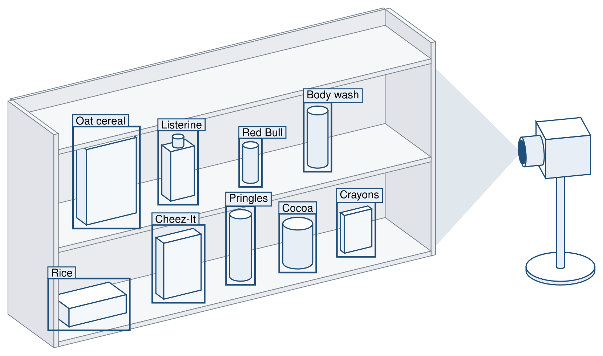
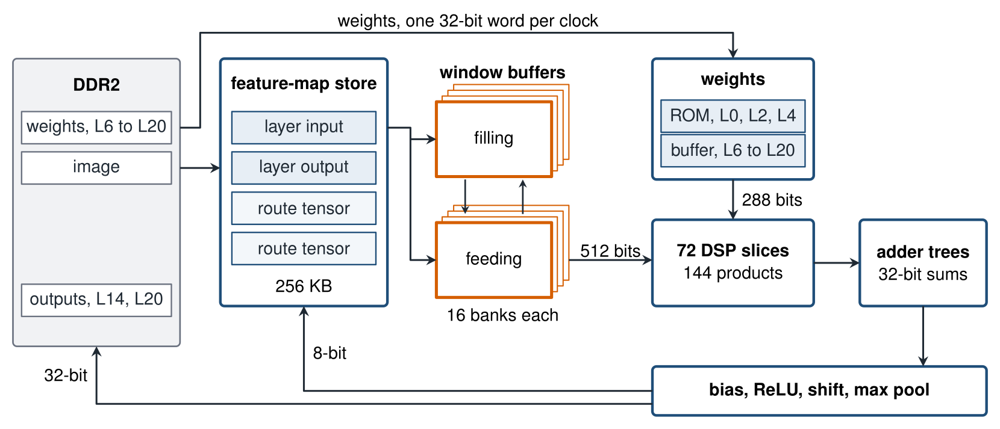
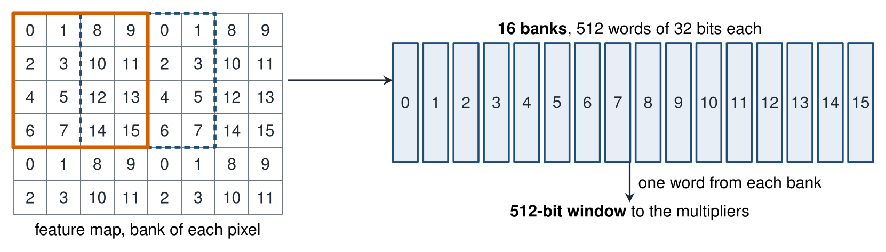
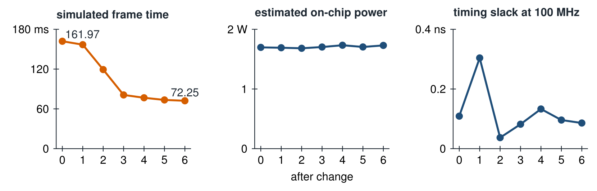

# YOLO FPGA Accelerator

A CNN accelerator in Verilog that runs all 11 convolutional layers of a YOLOv2 detector on the Artix-7 FPGA of a Nexys A7-100T board, so that a robot or a shelf camera can recognize 60 kinds of store products on small, low-power hardware. Built for the 2026 Deep Learning Hardware Design Contest (3rd Place).



12.7 frames per second measured on the board at 100 MHz, 1.730 W of on-chip power (Vivado estimate), and 80.91% mAP from 8-bit weights against 55.04% for the organizers' 8-bit reference.

**Technical summary**

- **Memory hierarchy for data reuse.** Feature maps stay on chip, and each tile is fetched once for all output channels.
- **Two products per DSP slice.** 144 products per clock from 72 DSP48 slices.
- **Transfers under the computation.** Six schedule changes cut the simulated frame time by a factor of 2.24; the Vivado power estimate stayed at 1.68 to 1.73 W.
- **Bit-exact verification.** RTL simulation and all 458 board outputs of the 229 test images equal an integer model.

## Problem and users

A robot or a shelf camera that recognizes products needs detection on small, low-power hardware next to the camera. The contest gave a trained detector for 60 kinds of shelf products (1.035 billion operations per frame), 229 test images, a C program that runs and scores it, and the board. Entries were ranked by

```text
score = 10^4 / P x max(0, mAP - 0.2) x max(0, fps - 5)
```

with P the on-chip power and fps counted at 100 MHz. A faster schedule pays only if it costs less power than it gains, and mAP lost in quantization costs score directly.

## Design requirements

- **Throughput.** 5 frames per second at 100 MHz takes at least 26 multiply-accumulates in every clock.
- **Memory bandwidth.** DDR2 is reached through one 32-bit AXI port, and the 3.09 MB of weights are five times the 607.5 KB of block RAM.
- **Power.** On-chip power divides the score.
- **Accuracy.** 8-bit arithmetic, as in the contest's quantized C path, close to the 81.76% mAP of the floating-point model.
- **Clock.** Timing met at 100 MHz, where the frame rate is counted.

## System architecture


Navy boxes are code in this repository, the orange box is the multiplier array, and the gray box is the DDR2 memory on the board.

Where the contest's C program would compute the network, a hook (`host/yolo_hw_forward.c`) runs `host/yolo_jtag_forward.ps1`, which writes the image, the weights of layers 6 to 20 and a run request into DDR2 over JTAG. The MicroBlaze firmware polls a mailbox in DDR2, starts the accelerator (`firmware/yolo_hw_forward.c`) and writes back the status and the cycle count. The PC reads the two output tensors, and the contest's own code decodes the boxes and computes mAP.

- **Existing:** the contest's network, test images and C program; the files in `contest/`, changed here and owned by the organizers; Xilinx IP.
- **Developed for this project:** the accelerator RTL in `rtl/`, the changes in `contest/`, the quantization in `quant/`, the firmware, the host scripts and the Vivado scripts.

## Memory hierarchy and data reuse



Every clock the multiplier array takes a 512-bit window and a 288-bit weight word, 25 times what the 32-bit AXI port delivers, so each piece of data is kept where it is reused.

- **DDR2** holds only the input image, the weights of layers 6 to 20 and the two output tensors.
- **Feature-map store.** 256 KB, sized for the largest feature map, the 128 × 128 × 16 output of the first layer after pooling. Each map is a one-dimensional array with structured addresses, so route layers read their inputs in place and the concatenated input of layer 20 is never built.
- **Window buffers.** A tile stays while the weights of every output channel pass over it, so each tile is fetched once. One buffer feeds the multipliers while the other refills.
- **Weights.** Layers 0, 2 and 4 (23 KB) sit in a 1024 × 288-bit ROM; the later layers stream into a 4096 × 72-bit buffer (`rtl/gbuff_param.v`).
- **Output stage.** Adder trees and 32-bit accumulation, then bias, ReLU, a per-channel shift, 8-bit clamp and max pooling back into the store (`rtl/compute.v`). Layers 14 and 20 send their 32-bit sums to DDR2, the integers the contest's decoder expects.

## Window buffers in 16 banks



A 2 × 2 output tile of a 3 × 3 kernel needs a 4 × 4 window of four channels in one clock, and the next tile starts two pixels on. Each buffer is split into 16 banks by row and column modulo 4, one pixel's four channels per word, so any 4 × 4 window holds each bank once and the 16 banks deliver 512 bits in one clock. A single wide memory would read the shared pixels of neighboring windows again, and banks by row alone would collide. `rtl/buffer_base.v` reorders the 16 words as the tile moves. In a 1 × 1 layer the same 512 bits are read as 2 × 2 pixels of 16 channels (`rtl/mac__kernel.v`), so one array serves both kernel sizes.

## Two products per DSP slice


One 288-bit weight word, a 3 × 3 kernel for four channels, serves all four outputs of a tile: 144 multiplications per clock. Two outputs multiply the same weight by neighboring activations, and a DSP48 slice multiplies 25 by 18 bits, so both fit in one slice (`rtl/mul.v`). The activations are unsigned after ReLU and the weight's magnitude has 8 bits, so the low product stays below bit 15, clear of the high one at bit 17. The weight's sign is applied to both products after the slice. All 2^24 combinations of a weight and two activations simulate without error.

| 144-product array, out-of-context synthesis | DSP slices | LUTs | Flip-flops |
|---|---|---|---|
| Two products per slice (used) | 72 | 5,857 | 8,541 |
| One product per slice | 144 | 1,429 | 3,753 |
| Vivado's own mapping | 0 | 11,726 | 10,953 |

Packing halves the DSP slices for 4,428 more LUTs and 4,788 more flip-flops, for the sign handling and the pipeline registers.

## Moving transfers under the computation


With the data on chip, the frame time was set by the clocks in which the multipliers waited. Six schedule changes hide them, each a switch in `rtl/yolo_build_config_h.v`:

| Change | Switch | Frame time |
|---|---|---|
| Before | | 161.97 ms |
| 1. No window refill when a one-buffer layer restarts for more output channels | `YOLO_REFILL_SKIP` | 156.81 ms |
| 2. First layer starts while the image arrives, output channels back to back | `YOLO_L0_IFM_OVERLAP`, `YOLO_L0_OC_BURST` | 119.28 ms |
| 3. Next output channel right after the last input of the current one, 3 × 3 layers | `YOLO_OC_PIPELINE` | 81.03 ms |
| 4. Weights stream from DDR2 during compute | `YOLO_WT_STREAM` | 76.77 ms |
| 5. Channel pipelining in the 1 × 1 layers | `YOLO_IMODE_OCP` | 73.49 ms |
| 6. Output stores of layers 14 and 20 during the next partition | `YOLO_STORE_OVERLAP` | 72.25 ms |

Frame times are from the full-frame RTL simulation (one test image, a memory that answers each read in one clock), with outputs identical to the integer model in every configuration. Each change also passed the simulation with the memory slowed 16 times and a board run before the next.

## Power and clock



After routing, Vivado's estimate gives 0.897 W of the 1.730 W to the DDR2 controller and 0.510 W to the accelerator. Across the six changes the estimate stayed between 1.68 and 1.73 W while the simulated frame time fell 2.24 times.

The accelerator runs on its own 100 MHz clock, apart from the 81.25 MHz user clock of the DDR2 controller, with AXI clock converters between them (`fpga/create_bd.tcl`). Timing was met at 100 MHz after every change.

## 8-bit quantization per output channel

Each output channel gets a power-of-two exponent so that its weights fill the 8-bit range and its bias fits 16 bits (`quant/make_pc2.py`). The channel's shift grows by the same exponent, so the RTL, which already shifts per channel, stays unchanged. Fitting the exponent to the 99.9th percentile of the channel's weights lets a few weights saturate instead of costing the rest their resolution (`quant/make_pc4.py`).

| Quantization (contest scorer, 229 test images) | mAP |
|---|---|
| Organizers' 8-bit reference | 55.04% |
| One multiplier per layer, tuned by hand | 78.90% |
| Power-of-two exponent per output channel | 80.74% |
| Same, fitted to the 99.9th percentile (used) | 80.91% |
| Floating point | 81.76% |

## Bit-exact verification

An integer model in Python computes the network with the hardware's arithmetic; its outputs gave the mAP above.

- **RTL simulation.** On a test image, the feature-map store matches the model word for word after all 11 layers, and both output tensors match, also with the memory slowed 16 times.
- **Board.** All 458 output tensors of the 229 test images match the model word for word. The batch ran before two switches were turned on, `YOLO_STORE_OVERLAP` (change 6) and `YOLO_TRUE_LATENCY_COUNTER`, which change only when outputs are stored and where the cycle counter stops.

## Results

| | Value | Condition |
|---|---|---|
| Frame time | 78.66 ms, 12.7 frames per second | board cycle counter at 100 MHz, start to last output in DDR2, mean of three runs |
| Accuracy | 80.91% mAP | contest scorer, 229 test images |
| On-chip power | 1.730 W | Vivado report after routing |
| Timing | worst slack +0.086 ns at 100 MHz | Vivado report after routing |
| Resources | 29,167 LUTs (46%), 129.5 block RAM tiles (96%), 72 DSP slices (30%) | whole design |

## Repository structure

| Path | Contents |
|---|---|
| `rtl/` | Layer sequencer, buffers, multiplier array, output stage, build switches |
| `contest/` | Contest files changed in this project ([contest/README.md](contest/README.md)) |
| `quant/` | Per-channel quantization, ROM files for synthesis |
| `fpga/` | Vivado project, block design and implementation |
| `firmware/` | MicroBlaze mailbox loop, UART commands, accelerator driver |
| `host/` | Hook in the contest's C program, JTAG run scripts |

## Setup and run

Software: Vivado 2022.2 with the Nexys A7 board files and XSCT, Python 3 with NumPy, and the contest's `bin/` folder and C program. The ROM files must be readable from the synthesis run as `rom/*.hex`.

```sh
export CONTEST_BIN=/path/to/contest/bin
cd quant && python make_pc2.py && python make_pc4.py
mkdir -p params && cp -r log_param_pc4b params/log_param
python make_roms.py --skeleton-bin params --out rom
cd ..
vivado -mode batch -source fpga/create_project.tcl -tclargs <project dir> <repository> <board files>
vivado -mode batch -source fpga/create_bd.tcl -tclargs <project dir> <board files>
vivado -mode batch -source fpga/implement.tcl -tclargs <project dir> <board files>
xsct firmware/create_app.tcl <project dir>/yolo_mb_board_bd_wrapper.xsa <workspace>
```

One board run programs the FPGA, stages the weights and writes the two output tensors and the cycle count into `runtime/`:

```powershell
# -Seq 1000 stays clear of the batch's run numbers 1 to 229
host\yolo_jtag_forward.ps1 -InputHex <CONV00_input_32b.hex> -OutDir runtime -Seq 1000 `
    -Program -Bitstream <bitstream> -Elf <firmware ELF> -ReloadWeights
```

For all 229 images, build the contest's C program with `host/yolo_hw_forward.c` and the `W_MULT` and `IN_MULT` tables of `quant/quantlib.py`, call `yolo_hw_forward_if_requested(net, X, path, index)` before `network_predict_quantized`, and list the input files in a manifest (`index`, `stem`, `image`, `input`):

```powershell
$env:YOLO_HW_BACKEND = "jtag"; $env:YOLO_HW_JTAG_SKIP_WEIGHT_STAGE = "1"
$env:YOLO_HW_JTAG_SCRIPT = "<repository>\host\yolo_jtag_forward.ps1"; $env:YOLO_HW_JTAG_MANIFEST = "<manifest.tsv>"
yolo_cpu detector map yolohw.names aix2024.cfg aix2024.weights -thresh 0.24 -quantized
```
