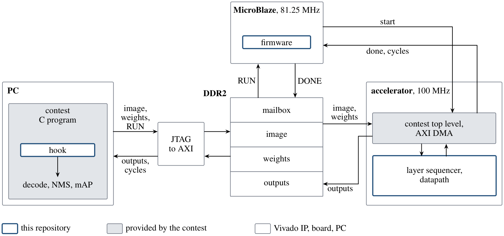
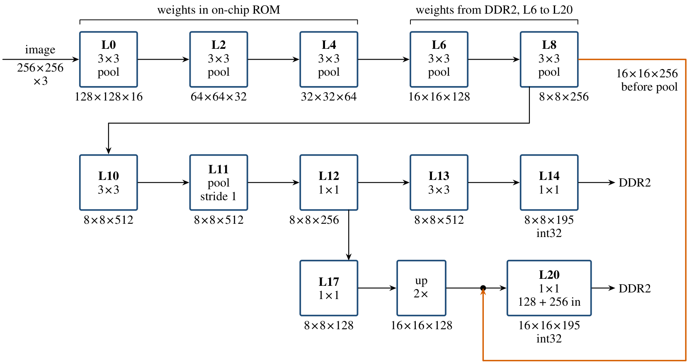
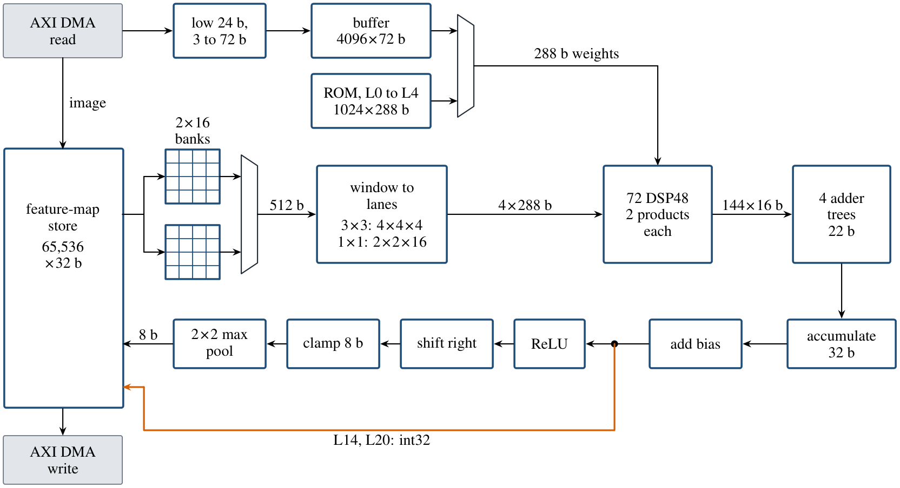
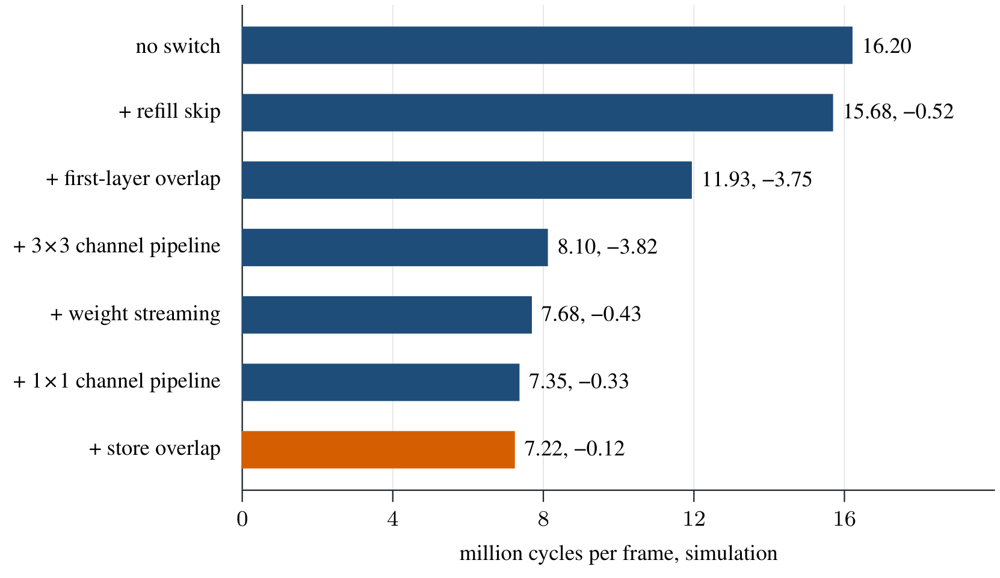
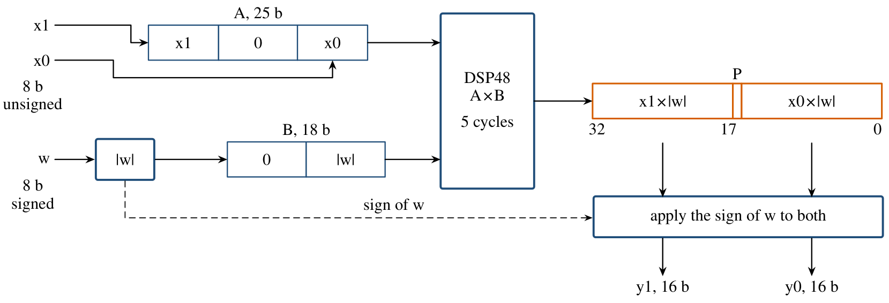
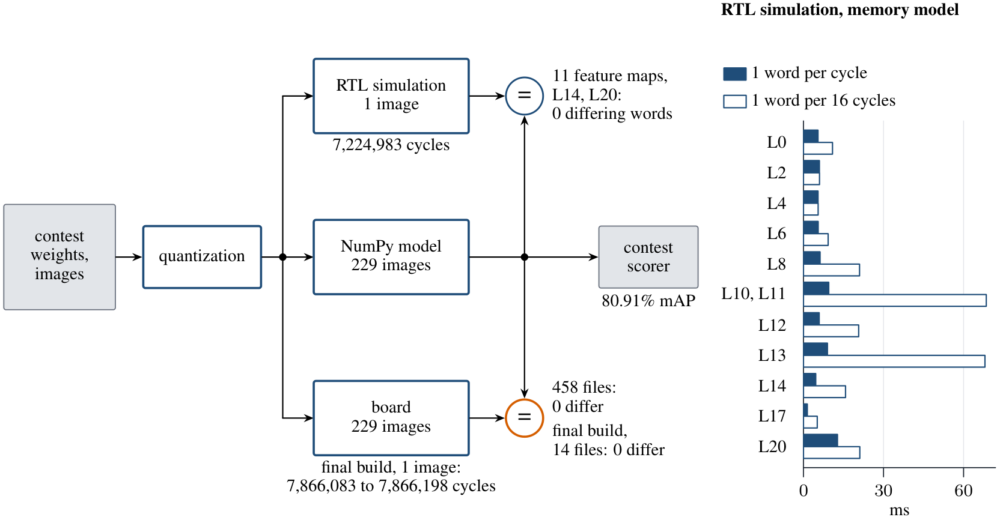

# YOLO FPGA Accelerator

An accelerator that runs a YOLOv2-tiny style object detector on the Artix-7 FPGA of a Nexys A7-100T board. It was built for the 2026 Deep Learning Hardware Design Contest, which asked for inference hardware that recognizes 60 kinds of products on an unmanned store shelf, with a trained network, test images, a C program that runs and scores the network, and the board given by the organizers. The FPGA computes all eleven convolution layers at 100 MHz, and the PC decodes the boxes with the contest's own code. Entries were ranked by

```text
score = 10^4 / P x max(0, mAP - 0.2) x max(0, fps - 5)
```

with P the on-chip power of the design, and this entry won third prize.

| | Result |
|---|---|
| Frame time on the board | 78.66 ms, 12.7 frames per second: 7,866,083 to 7,866,198 cycles of the accelerator's own counter in three runs |
| Outputs on the board | identical, word for word, to a bit-exact NumPy model of the hardware on all 229 test images |
| Accuracy | 80.91% mAP with the contest's scorer on the 229 test images, against 55.04% for the organizers' reference 8-bit model and 81.76% in floating point |
| Resources | 72 of 240 DSP slices, 129.5 of 135 block RAM tiles, 29,167 LUTs, 1.730 W on-chip power (Vivado estimate) |
| Build switches | the simulated frame falls from 16,196,772 to 7,224,983 cycles, 2.24 times faster, with the same outputs |

The frame time is the accelerator's run from the start command to the last output in DDR2; the image arrives over JTAG before it. The 229-image comparison ran on the build before the last two switches of `rtl/yolo_build_config_h.v`, which change when outputs are written and where the counter stops; the final build gave identical outputs on the 7 images it ran.

## How it works



The PC runs the contest's C program. Where the program would compute the network, a hook (`host/yolo_hw_forward.c`) hands the image to the board: `host/yolo_jtag_forward.ps1` runs `host/yolo_jtag_batch.tcl` in Vivado, which writes the input image, the weights of layers 6 to 20 and a run request into DDR2 over JTAG. The MicroBlaze firmware polls a mailbox in DDR2, runs the accelerator through its control registers (`firmware/yolo_hw_forward.c`) and writes the status and the cycle count back. The batch script reads the two output tensors and the cycle count out of DDR2, and the contest's code decodes the boxes, removes duplicates and computes mAP.



A layer sequencer (`rtl/cnn_ctrl_v2.v`) runs the layers in order and, for each one, loads the input and the weights, computes, and stores the result. Feature maps between layers stay in a 256 KB feature-map store (65,536 words of 32 bits), sized for the largest one, the 128 x 128 x 16 output of the first layer after pooling. Only the input image, the weights of layers 6 to 20 and the two output tensors cross the DDR2 interface. Layer 8 writes its pooled 8 x 8 x 256 output for layer 10 and a 16 x 16 x 256 copy taken before pooling, which layer 20 reads together with the output of layer 17 upsampled to 16 x 16 x 128.



Two window buffers of 16 memory banks each feed the multiplier array; one is filled from the feature-map store while the other is read. Every cycle the array takes a 512-bit window and one 288-bit weight word and produces partial sums for a 2 x 2 tile of output pixels. In a 3 x 3 layer the window is 4 x 4 pixels of four input channels and the weight word a 3 x 3 kernel for the same channels: 4 outputs of 36 products each, 144 multiplications per cycle on 72 DSP slices. In a 1 x 1 layer the window is 2 x 2 pixels of 16 input channels, and each output uses 16 of its 36 lanes (`rtl/mac__kernel.v`). Four 36-input adder trees reduce the products, and the sums are accumulated in 32 bits over the input channels. Then the bias is added. Layers 14 and 20 write this signed 32-bit value as their output. Every other layer applies ReLU, shifts by the channel's power of two, clamps to 8 bits and, where the layer has it, takes the 2 x 2 maximum, and writes the result back to the store (`rtl/compute.v`).

## Design decisions

**Moving data under the computation.** The design started from the judgment in the midterm review that moving data between memories and into the array, more than the multipliers, would set the frame time. Each step that hides a transfer or a pipeline drain is a switch in `rtl/yolo_build_config_h.v`. The first layer starts while its input is still arriving and issues its 16 output channels back to back, weights stream in while earlier weights are used, the next output channel enters the pipeline right after the last input of the current one, output stores run under the next part's compute, and refills that a single-page layer does not need are skipped.



The full-frame simulation was run with the switches added in the order they were built (Vivado simulator, memory model returning one word per cycle). Together they take the frame from 16,196,772 to 7,224,983 cycles, from 161.97 ms to 72.25 ms at 100 MHz, and every configuration gives outputs identical to the NumPy model. The two largest steps are the first layer, which drops from 43.0 ms to 5.5 ms once it computes while its input arrives and issues its channels back to back, and the channel pipeline of the 3 x 3 layers, which removes the pipeline drain between output channels in layers 2 to 13.

| Switch added | Frame cycles | Saved | L0 | L2 | L4 | L6 | L8 | L10, L11 | L12 | L13 | L14 | L17 | L20 |
|---|---|---|---|---|---|---|---|---|---|---|---|---|---|
| none | 16,196,772 | | 43.02 | 25.07 | 15.18 | 10.58 | 9.39 | 13.62 | 7.56 | 13.13 | 6.12 | 2.05 | 16.25 |
| `YOLO_REFILL_SKIP` | 15,680,613 | 516,159 | 43.02 | 25.07 | 15.18 | 10.58 | 9.39 | 11.08 | 7.56 | 10.59 | 6.12 | 1.97 | 16.25 |
| `YOLO_L0_OC_BURST`, `YOLO_L0_IFM_OVERLAP` | 11,927,551 | 3,753,062 | 5.49 | 25.07 | 15.18 | 10.58 | 9.39 | 11.08 | 7.56 | 10.59 | 6.12 | 1.97 | 16.25 |
| `YOLO_OC_PIPELINE` | 8,102,911 | 3,824,640 | 5.49 | 6.02 | 5.50 | 5.74 | 7.01 | 9.93 | 7.56 | 9.44 | 6.12 | 1.97 | 16.25 |
| `YOLO_WT_STREAM` | 7,677,136 | 425,775 | 5.49 | 6.02 | 5.50 | 5.56 | 6.27 | 9.52 | 6.56 | 9.03 | 5.35 | 1.80 | 15.67 |
| `YOLO_IMODE_OCP` | 7,348,595 | 328,541 | 5.49 | 6.02 | 5.50 | 5.56 | 6.27 | 9.52 | 5.94 | 9.03 | 4.89 | 1.49 | 13.78 |
| `YOLO_STORE_OVERLAP` (final) | 7,224,983 | 123,612 | 5.49 | 6.02 | 5.50 | 5.56 | 6.27 | 9.52 | 5.94 | 9.03 | 4.64 | 1.49 | 12.79 |

Layer columns in ms, simulation (`sim/run_variant.ps1`, `sim/ablation_table.py`, `results/ablation.txt`).

**Two products per DSP slice.** Each DSP48 slice multiplies a 25-bit by an 18-bit operand. Two 8-bit activations of neighboring output pixels share one weight, so they are packed into one operand and multiplied by the weight's magnitude in one slice (`rtl/mul.v`).



The activations are unsigned after ReLU and the magnitude of the signed weight is at most 128, so the low product x0 x |w| is at most 32,640 and stays below bit 15; P[15:0] is x0 x |w| and P[32:17] is x1 x |w|. The weight's sign is carried along the five pipeline stages and negates both 16-bit products when the weight is negative. A simulation of all 2^24 combinations of weight and two activations gives no error (`results/mul_sim.log`). Synthesized out of context for the XC7A100T, the 144-product array takes:

| Multiplier array | DSP slices | LUTs | Flip-flops |
|---|---|---|---|
| Two products per slice (used) | 72 | 5,857 | 8,541 |
| One product per slice | 144 | 1,429 | 3,753 |
| Vivado's own choice for 8 x 8 products | 0 | 11,726 | 10,953 |

(`sim/synth_mul_array.tcl`, `results/mul_array_synthesis.txt`.) Packing halves the DSP slices of the array; the 4,428 extra LUTs hold the sign handling and the pipeline registers that `rtl/mul.v` keeps outside the slice.

**One array for both kernel sizes.** The 3 x 3 and the 1 x 1 layers share the multiplier array, which reads the 512-bit window in two ways (`rtl/mac__kernel.v`). As the midterm notes put it, early layers gain from parallelism over pixels and deeper layers from parallelism over channels, and the same multipliers then handle the 1 x 1 layers without a second datapath.

**Banked window buffers.** A 2 x 2 output tile of a 3 x 3 kernel needs a 4 x 4 window in one cycle, and the tile moves by two pixels. The buffer is split into 16 banks by row mod 4 and column mod 4, so any 4 x 4 window touches each bank once; the bank map stays fixed and only the position of each bank inside the window rotates as the tile moves (`rtl/buffer_base.v`). A plain buffer would either read the overlap twice or hit bank conflicts.

**Feature maps and route tensors on chip.** The midterm design compared three places for a layer's output: a split of the on-chip store, a second on-chip buffer, which might not fit in the block RAM, and DDR2, which costs bandwidth. The split won because the first layer's output after pooling fits next to its input. Each tensor has a fixed base address, the tensors that layers 17 and 20 reuse have their own regions, and layer 20 reads its two inputs from them, so the concatenated tensor is never built.

**Weights in ROM for the first layers.** The weights total 3.09 MB, five times the block RAM. The 23 KB of layers 0, 2 and 4 sit in a 1024 x 288-bit ROM; the weights of layers 6 to 20 stream from DDR2, 24 bits of each 32-bit word, into a 4096 x 72-bit buffer read four entries at a time (`rtl/gbuff_param.v`).

**32-bit output tensors.** Layers 14 and 20 write the same 32-bit integers that the contest's quantized C path computes before its decoder, so the contest's decoder, duplicate removal and mAP code run on the board's outputs unchanged. Scored with the Python version of the scorer, the 32-bit outputs and the same values cut to 16 bits give 80.45% and 80.46% mAP on the 229 images (`quant/eval_heads.py`, `results/heads_int32_vs_int16.txt`). The 32-bit output of layer 20 does not fit next to its input in the store (49,920 + 24,576 words against 65,536), so it is written out 32 channels at a time.

**Per-channel power-of-two quantization.** The project first tuned one multiplier per layer by hand. Each output channel then gets an extra power-of-two exponent, chosen so that its weights fill the 8-bit range and its bias still fits 16 bits, with rounding in place of the reference code's truncation. The channel's shift grows by the same exponent, so the activations keep the layer's scale and the RTL stays the same. Fitting the exponent to the 99.9th percentile of each channel's weights lets a few weights saturate instead of costing the rest their resolution (`quant/make_pc2.py`, `quant/make_pc4.py`). The copy of layer 8 taken before pooling is stored with a shift one bit smaller than the pooled output (`rtl/compute.v`, `quant/hw_pipeline.py`).

| Quantization, contest scorer, 229 images | mAP |
|---|---|
| One multiplier per layer, tuned by hand | 78.90% |
| Power-of-two exponent per output channel | 80.74% |
| Same, fitted to the 99.9th percentile | 80.91% |

(`results/map_per_layer.txt`, `results/map_per_channel.txt`, `results/map_229_images.txt`.)

**The board computes, the PC scores.** The board runs the network and the PC keeps the contest's decoding and mAP code, so the accuracy is measured by the organizers' evaluator and the MicroBlaze fits in 16 KB of local memory while the block RAM is 96% used.

**A separate 100 MHz clock.** The DDR2 controller's user clock is 81.25 MHz. The accelerator runs on its own 100 MHz clock, with AXI clock converters to the DDR2 side (`fpga/create_bd.tcl`). At 100 MHz the failing paths were in address generation, layer configuration and output writeback; they were closed by removing the reset from wide datapath registers and by registering values derived from the layer number once per layer. The routed design has a worst slack of +0.086 ns.

**A counter for the whole frame.** The cycle count ends at `network_done`, which the sequencer raises after the write DMA has reported the last part of layer 20 done (`rtl/cnn_ctrl_v2.v`, `contest/yolo_engine.v`).

## How it was checked



`quant/hw_pipeline.py` computes the network with the hardware's integer arithmetic. `sim/tb_frame.v` runs the whole network on the RTL with a behavioral AXI memory; `sim/golden.py` compares the feature-map store after every layer word for word, and `sim/check_heads.py` the two 32-bit output tensors. On one test image all 11 snapshots and both output tensors match, also with the memory model slowed to one word every 16 cycles. The simulated frame takes 7,224,983 cycles, 72.25 ms (Vivado 2025.2.1 reproduces the recorded log cycle for cycle). On the board the same build takes 7,866,083 to 7,866,198 cycles. The board's output tensors were compared file by file with the NumPy model's: 458 files of the 229-image batch and 14 files of the final build, with no differing word (`sim/compare_board_dumps.py`, `results/board_vs_reference.txt`).

| | Value | How it was obtained |
|---|---|---|
| Frame time | 78.66 ms, 12.7 fps | cycle counter read on the board, three runs on one image, 100 MHz (`results/board_frame_cycles.tsv`) |
| mAP | 80.91% | contest scorer, 229 images, on the NumPy model's output tensors that the board's equal |
| Power | 1.730 W | Vivado power report after routing (`results/power.rpt`) |
| Timing | worst slack +0.086 ns at 100 MHz | Vivado timing summary after routing (`results/timing_summary.rpt`) |
| Resources | 29,167 LUT (46%), 34,556 FF (27%), 129.5 BRAM tiles (96%), 72 DSP (30%) | Vivado utilization after routing, whole design (`results/utilization.rpt`) |

The firmware's driver follows the register accesses, addresses and mailbox values of the firmware ELF used for the board runs, as its disassembly shows, and is checked on the PC against a model of the control registers and DDR2 (`firmware/test/`, `results/firmware_test.txt`): it writes the soft reset, the two base addresses and the start pulse in that order, which is the order `sim/tb_frame.v` uses (base addresses first, then a one-cycle start), copies the weights once, and returns the cycle register and the outputs from the addresses in `rtl/cnn_ctrl_v2.v`.

## Repository

```text
rtl/                        accelerator: layer sequencer, buffers, multiplier array, post-processing, build switches
contest/                    files provided by the contest, modified in this project (contest/README.md):
                            top level, control registers, AXI-Lite wrapper, AXI DMA read and write
sim/                        full-frame testbench, NumPy reference, ROM generator, input files, board dump comparison,
                            build-switch runs, multiplier tests and synthesis
quant/                      quantization from the contest's weights, NumPy model of the hardware, Python scorer
firmware/                   MicroBlaze firmware: mailbox loop, UART commands, accelerator driver, host test
host/                       hook in the contest's C program, JTAG run scripts
fpga/                       Vivado project, block design and implementation scripts
results/                    Vivado reports, mAP logs, simulation logs, board records, experiment results
docs/                       figures of this README
```

## Run

The contest package goes outside this repository: its `bin/` folder with `aix2024.cfg`, `aix2024.weights` and `dataset/` (229 images and labels), and its C program. Build the C program with `host/yolo_hw_forward.c`, with the multiplier tables `W_MULT` and `IN_MULT` of `quant/quantlib.py`, and with `yolo_hw_forward_if_requested(net, X, path, index)` called before `network_predict_quantized` in the detector test and map loops.

**Quantization and the NumPy model.**

```sh
export CONTEST_BIN=/path/to/contest/bin
cd quant
python make_pc2.py && python make_pc4.py                                   # writes log_param_pc4b
python ../sim/make_inputs.py --exe <C program> --contest-bin $CONTEST_BIN --out ../inputs
python hw_pipeline.py run --params log_param_pc4b --manifest ../inputs/manifest.tsv --out reference --jobs 8
python eval_heads.py --reference reference --dataset $CONTEST_BIN/dataset --out heads_eval
```

**Full-frame simulation.** Copy `quant/log_param_pc4b` to `sim/params/log_param`, put one image's `CONV00_input.hex` from the C program in `sim/params/log_feamap/` and its two tensors from `quant/reference` in `sim/reference/`:

```sh
cd sim
python make_static_roms.py --skeleton-bin params --out rom
python golden.py prepare
xvlog -i ../rtl -i ../contest -f files.f
xelab tb_frame -s tb_frame
xsim tb_frame -R -testplusarg RUN_L20          # -testplusarg DMA_STRESS16 for the slow memory
python golden.py compare-hw --layers L0,L2,L4,L6,L8,L8RAW,L10,L11,L12,L13,L17
python check_heads.py params <image stem> reference
```

`sim/run_variant.ps1` repeats this for one set of build switches and `sim/ablation_table.py` turns the logs into `results/ablation.txt`. The multiplier tests and the array synthesis:

```sh
xvlog -d USE_DSP_PACKED ../rtl/mul.v tb_mul_exhaustive.v && xelab tb_mul_exhaustive -s mul_exh && xsim mul_exh -R
vivado -mode batch -source synth_mul_array.tcl -tclargs ../rtl packed util_packed.rpt
```

**Bitstream and firmware.** Vivado 2022.2 with the Nexys A7 board files; the ROM files from `sim/make_static_roms.py` must be readable from the synthesis run.

```sh
vivado -mode batch -source fpga/create_project.tcl -tclargs <project dir> <repository> <board store>
vivado -mode batch -source fpga/create_bd.tcl -tclargs <project dir> <board store>
vivado -mode batch -source fpga/implement.tcl -tclargs <project dir> <board store>   # bitstream, XSA, reports
xsct firmware/create_app.tcl <project dir>/yolo_mb_board_bd_wrapper.xsa <workspace>  # firmware ELF
sh firmware/test/build_and_run.sh gcc mb-gcc                                       # driver test on the PC
```

**On the board.** With the board on USB and the C program run from the contest's `bin/` folder:

```powershell
host\yolo_jtag_forward.ps1 -InputHex <input file of one image> -OutDir runtime `
    -Program -Bitstream <bitstream> -Elf <firmware ELF> -ReloadWeights
python sim\compare_board_dumps.py runtime quant\reference --present-only
```

For all 229 images, set `YOLO_HW_BACKEND=jtag` and run the C program's map command; the hook runs the board for each image. To score saved tensors instead, set `YOLO_HW_BACKEND=snapshot`, `YOLO_HW_SNAPSHOT_MODE=head32-partition` and `YOLO_HW_SNAPSHOT_DIR` to the folder of tensors:

```sh
yolo_cpu detector map yolohw.names aix2024.cfg aix2024.weights -thresh 0.24 -quantized
```
